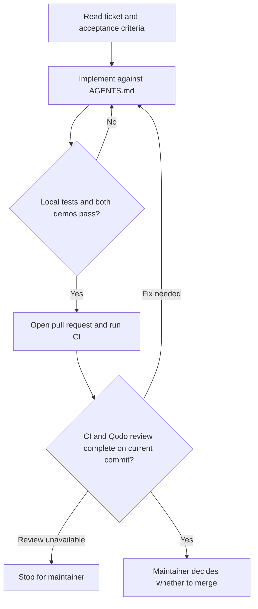

# Software Factory Hackathon

## Entry requirements

- Register for the event and create a Qodo account. Use Qodo during the hackathon and follow any tool-specific instructions for the challenge.
- Submit as an individual. Judges consider the challenges completed and the evidence showing how the workflow works and how decisions were made. Disclose pre-existing work, AI assistance, other contributors and third-party material.
- Post each completed challenge in its official [daily Discussion](https://github.com/orgs/qodo-hackathon/discussions). Missed challenges can be caught up. Social sharing is optional.
- Submit the final project in the official final Discussion. Include a repository the judges can access during judging, the final commit, a demo or written walkthrough, reproduction steps, daily submission links, Qodo and test evidence, contribution disclosures and known limitations. The cutoff is **December 3, 2026 at 4:00 p.m. Hong Kong time**, equivalent to the end of December 2 Pacific time.

[Rules and eligibility](https://hackathon.qodo.ai/rules/) · [Daily challenges](https://hackathon.qodo.ai/challenges/) · [Final template](https://github.com/qodo-hackathon/software-factory-hackathon/blob/main/templates/final-submission.md)

## Evidence to collect

| Challenge | Project evidence | Still needed for the challenge |
| --- | --- | --- |
| [Day 1 · First delivery](https://github.com/orgs/qodo-hackathon/discussions/2) | Working verifier, fixtures and focused PR | Completed Qodo review and a lesson from its findings |
| [Day 2 · Project rules](https://github.com/orgs/qodo-hackathon/discussions/4) | [AGENTS.md](../AGENTS.md) | Confirm that Qodo imports and activates the rules. Explain why shipment decisions are reserved for humans. |
| [Day 3 · Backlog](https://github.com/orgs/qodo-hackathon/discussions/5) | Linked GitHub ticket with acceptance criteria and a separate PR | Compare Qodo findings and test output to the ticket. Record follow-up decisions. |
| [Day 9 · Quality gates](https://github.com/orgs/qodo-hackathon/discussions/11) | Saved review gate and regression tests | Apply the gate to current-commit Qodo findings and record the result. |
| [Day 10 · Verification](https://github.com/orgs/qodo-hackathon/discussions/12) | Ticket, workflow diagram and CI | Demonstrate any remaining Qodo steps and mark where the ticket stopped. |
| [Day 14 · Approval workflow](https://github.com/orgs/qodo-hackathon/discussions/16) | Intended guard path is `passport.py`. The verifier controls whether evidence can advance. | Requires Qodo workflow admin access and two real test PRs. Any guarded change goes to a maintainer. |

This table covers the challenges directly supported by this increment. Daily posts and final submission are separate steps.

## Ticket to reviewed pull request

A completed workflow can include pre-commit review with Qodo's local reviewer and follow-up with Review Resolver. Those steps need an authenticated Qodo workspace. When GitHub is connected, use `/agentic_review` if automatic review has not started. After review, record the PR commit, review link, findings and any resulting change. Use [Qodo's review instructions](https://docs.qodo.ai/code-review/use-qodo-in-prs).

## Final submission draft

**Project.** IntelFactor Production Proof turns a purchase order, specification revision and production lot into an evidence packet. It detects an unresolved packaging exception, then shows the same lot ready for a human review after corrective action and reinspection.

**Walkthrough.** The [README](../README.md) runs both outcomes offline. The issue provides acceptance criteria. The pull request, unit tests and CI show how the coding agent turned the issue into a checked change. Add the final commit, review permalink, any corrections made in response to Qodo and links to the daily submissions before posting.

**Contribution and assistance.** The IntelFactor Evidence Passport concept predates this work. Codex generated this standalone implementation, synthetic fixtures, tests and documentation for Tony Lo in the hackathon window. Before submission, Tony should record his own design, review and verification contributions and disclose any additional assistance accurately.

**Limitations.** The prototype verifies the consistency and file integrity of a synthetic packet. Authentication, signing, provenance attestation, trusted specification ingestion and live factory integration are outside this increment. A human validates the evidence and decides whether to accept, release or pay for the lot.
