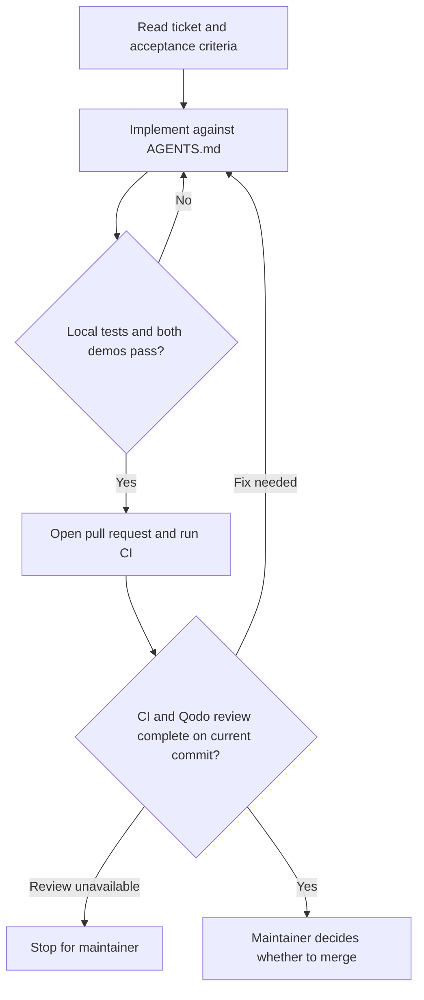

# Software Factory Hackathon

## Entry requirements

- Register for the event and create a Qodo account. Use Qodo during the hackathon and follow any tool-specific instructions for the challenge.
- Submit as an individual. Judges consider the challenges completed and the evidence showing how the workflow works and how decisions were made. Disclose pre-existing work, AI assistance, other contributors and third-party material.
- Post each completed challenge in its official [daily Discussion](https://github.com/orgs/qodo-hackathon/discussions). Missed challenges can be caught up. Social sharing is optional.
- Submit the final project in the official final Discussion. Include a repository the judges can access during judging, the final commit, a demo or written walkthrough, reproduction steps, daily submission links, Qodo and test evidence, contribution disclosures and known limitations. The cutoff is **December 3, 2026 at 4:00 p.m. Hong Kong time**, equivalent to the end of December 2 Pacific time.

[Rules and eligibility](https://hackathon.qodo.ai/rules/) · [Daily challenges](https://hackathon.qodo.ai/challenges/) · [Final template](https://github.com/qodo-hackathon/software-factory-hackathon/blob/main/templates/final-submission.md)

## Evidence to collect

Status as of November 24, 2026. "Blocked: Qodo" means the step needs Qodo connected to this repository, which hasn't happened yet.

| Challenge | Project evidence so far | Still needed |
| --- | --- | --- |
| [Day 1 · First delivery](https://github.com/orgs/qodo-hackathon/discussions/2) | Working verifier, fixtures, focused [PR #2](https://github.com/tonesgainz/intelfactor-production-proof/pull/2), green CI | Blocked: Qodo. Needs a completed review on the PR head and one lesson from its findings |
| [Day 2 · Project rules](https://github.com/orgs/qodo-hackathon/discussions/4) | [AGENTS.md](../AGENTS.md) with five rules and a quality gate | Blocked: Qodo. Confirm the rules are imported into Review Standards |
| [Day 3 · Backlog](https://github.com/orgs/qodo-hackathon/discussions/5) | [Issue #1](https://github.com/tonesgainz/intelfactor-production-proof/issues/1) with acceptance criteria. Agent works tickets through the `gh` CLI | Second ticket (AQL sampling plan) on its own branch and PR. Compare the review and tests against each ticket |
| Day 4 · Automated trigger | — | Run the `ready-for-agent` label through a scheduled agent run with a retry limit |
| Day 5 · Self-improving rules | — | Blocked: Qodo. Needs a mined or agent-proposed rule traced to a review comment |
| Day 6 · Codebase Wisdom | — | Blocked: Qodo Agentic Toolbox. Investigate one ticket before building it |
| Day 7 · Review Resolver | — | Blocked: Qodo. Resolve findings on an open PR and record the reasons for any left unchanged |
| Day 8 · Local review | — | Blocked: Qodo. Review uncommitted changes before committing |
| [Day 9 · Quality gates](https://github.com/orgs/qodo-hackathon/discussions/11) | Gate saved in AGENTS.md | Apply the gate to findings on the current commit |
| [Day 10 · Verification](https://github.com/orgs/qodo-hackathon/discussions/12) | Diagram below and CI | Add the Qodo steps and walk one real ticket through to main |
| Day 11 · Custom review | — | Blocked: Qodo. Save the before and after reviews of one unchanged PR |
| Day 12 · Source context | Issue references in PR descriptions | Blocked: Qodo. Check one acceptance criterion against the review |
| Day 13 · Skill | — | Write a `SKILL.md` for the evidence-packet check and use it in a fresh session |
| [Day 14 · Approval workflow](https://github.com/orgs/qodo-hackathon/discussions/16) | Intended guard path is `passport.py` | Blocked: Qodo. One workflow, one guard and two real PRs |
| Day 15 · Show your factory | — | A public post tagging Qodo |
| Day 16 · Arnica scan | — | Connect Arnica, record the completed scan and add it to the diagram |

## Ticket to reviewed pull request

A completed workflow can include pre-commit review with Qodo's local reviewer and follow-up with Review Resolver. Those steps need an authenticated Qodo workspace. When GitHub is connected, use `/agentic_review` if automatic review has not started. After review, record the PR commit, review link, findings and any resulting change. Use [Qodo's review instructions](https://docs.qodo.ai/code-review/use-qodo-in-prs).

## Final submission draft

### Project

**IntelFactor Production Proof** gives a manufacturer and brand a shared evidence packet for one purchase order, production lot and specification revision. It demonstrates a packaging label mismatch, verification of the corrective action, and handoff to a human reviewer.

- [Project repository](https://github.com/tonesgainz/intelfactor-production-proof)
- [Implementation PR](https://github.com/tonesgainz/intelfactor-production-proof/pull/2)
- [Verified implementation commit](https://github.com/tonesgainz/intelfactor-production-proof/commit/df89aa68b030c67c2a746f728b0ae0cba614895c)

Before filing, verify read access for judges and update the commit link if the implementation changes.

### Walkthrough

1. Run `python passport.py examples/blocked.json examples/evidence`. The result is `blocked` with an open exception and missing inspection evidence.
2. Run `python passport.py examples/ready.json examples/evidence`. The same lot reaches `ready_for_human_review` with verified rework and inspection records. The reviewer decides whether the lot can be accepted or released.
3. Follow [issue #1](https://github.com/tonesgainz/intelfactor-production-proof/issues/1) through the implementation PR and review [AGENTS.md](../AGENTS.md) to see how acceptance criteria became verification rules.

The [README](../README.md) has reproduction instructions. Python 3.11 or newer is the only local dependency.

### Completed challenges

Add links to the official daily Discussion comments as they are posted. The challenge table above records evidence available and remaining work for each challenge.

### Verification and Qodo’s role

[GitHub Actions passed](https://github.com/tonesgainz/intelfactor-production-proof/actions/runs/45227844148) on Python 3.11 and 3.13. The suite has 11 tests and exercises both demo outcomes. It checks order, lot and revision matching, missing or modified files, and exception handling.

[Qodo review was requested](https://github.com/tonesgainz/intelfactor-production-proof/pull/2#issuecomment-7110201651). A completed Qodo review is pending. Add the review link for the submitted commit, the specific findings investigated, and the resulting changes or decisions.

### Contribution and assistance

- **Pre-existing work.** The IntelFactor Evidence Passport concept (an evidence packet tied to one order, lot and specification revision) is Tony Lo's and predates the hackathon. No earlier IntelFactor code is reused in this repository.
- **Tony Lo.** Chose the project and its buyer problem, set the boundary that people own acceptance, shipment and payment decisions, directed the AI agents and decides every merge. *(Before filing, Tony adds any specific design, review or verification work of his own.)*
- **Codex (OpenAI).** Generated the initial standalone build during the hackathon: `passport.py`, the synthetic fixtures and evidence files, the 11 unit tests, the GitHub Actions workflow, AGENTS.md, the README and the first version of this document (commits [`df89aa6`](https://github.com/tonesgainz/intelfactor-production-proof/commit/df89aa68b030c67c2a746f728b0ae0cba614895c) and `1c94842`).
- **Claude (Anthropic, Claude Opus 5.5 in claude.ai).** Read the hackathon rules and all 16 released challenges and mapped each one to this repository's evidence (the table above). Checked the repository for confidential data before it was made public, re-ran the test suite, rewrote this disclosure and drafted the daily Discussion submissions. Filed [issue #3](https://github.com/tonesgainz/intelfactor-production-proof/issues/3) (ISO 2859-1 sampling check) and implemented it from the ticket on its own branch: `sampling.py`, the verifier wiring, 14 new tests and the updated `ready` example. Later Claude work is listed here with its commit or PR as it lands.
- **Review and security tools.** Qodo (code review, review standards, Agentic Toolbox) and Arnica (repository scan) are used under their hackathon accounts. Their findings and the decisions taken on them are linked from each daily submission.
- **Third-party material.** The runtime uses only the Python standard library. CI uses GitHub's `actions/checkout` and `actions/setup-python` (MIT). All order, lot and evidence data is synthetic.

### Limitations

The prototype verifies the consistency and file integrity of a synthetic packet. Authentication, signing, provenance attestation and live factory integration are outside this increment. A human validates the source evidence and makes acceptance, shipment and payment decisions.

## Day 1 introduction draft

I’m Tony Lo, building IntelFactor Production Proof. It’s an Evidence Passport for manufacturers and brands that need to know whether a lot matches the agreed spec before it ships. My first delivery follows one synthetic lot from a packaging mismatch to rework, reinspection and a packet a person can review. [Implementation PR](https://github.com/tonesgainz/intelfactor-production-proof/pull/2) · [Verification run](https://github.com/tonesgainz/intelfactor-production-proof/actions/runs/45227844148).

Add the Qodo review and one decision it informed before reporting Day 1 as complete.
