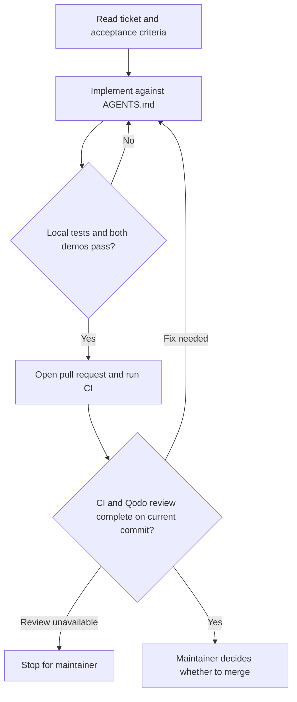

# Software Factory Hackathon

## Entry requirements

- Register for the event and create a Qodo account. Use Qodo during the hackathon and follow any tool-specific instructions for the challenge.
- Submit as an individual. Judges consider the challenges completed and the evidence showing how the workflow works and how decisions were made. Disclose pre-existing work, AI assistance, other contributors and third-party material.
- Post each completed challenge in its official [daily Discussion](https://github.com/orgs/qodo-hackathon/discussions). Missed challenges can be caught up. Social sharing is optional.
- Submit the final project in the official final Discussion. Include a repository the judges can access during judging, the final commit, a demo or written walkthrough, reproduction steps, daily submission links, Qodo and test evidence, contribution disclosures and known limitations. The cutoff is **December 3, 2026 at 4:00 p.m. Hong Kong time**, equivalent to the end of December 2 Pacific time.

[Rules and eligibility](https://hackathon.qodo.ai/rules/) · [Daily challenges](https://hackathon.qodo.ai/challenges/) · [Final template](https://github.com/qodo-hackathon/software-factory-hackathon/blob/main/templates/final-submission.md)

## Evidence to collect

| Challenge | Project evidence | Still needed for the challenge |
| --- | --- | --- |
| [Day 1 · First delivery](https://github.com/orgs/qodo-hackathon/discussions/2) | Working verifier, fixtures and focused PR | Completed Qodo review and a lesson from its findings |
| [Day 2 · Project rules](https://github.com/orgs/qodo-hackathon/discussions/4) | [AGENTS.md](../AGENTS.md) | Confirm that Qodo imports and activates the rules. Explain why shipment decisions are reserved for humans. |
| [Day 3 · Backlog](https://github.com/orgs/qodo-hackathon/discussions/5) | Linked GitHub ticket with acceptance criteria and a separate PR | Compare Qodo findings and test output to the ticket. Record follow-up decisions. |
| [Day 9 · Quality gates](https://github.com/orgs/qodo-hackathon/discussions/11) | Saved review gate and regression tests | Apply the gate to current-commit Qodo findings and record the result. |
| [Day 10 · Verification](https://github.com/orgs/qodo-hackathon/discussions/12) | Ticket, workflow diagram and CI | Demonstrate any remaining Qodo steps and mark where the ticket stopped. |
| [Day 14 · Approval workflow](https://github.com/orgs/qodo-hackathon/discussions/16) | Intended guard path is `passport.py`. The verifier controls whether evidence can advance. | Requires Qodo workflow admin access and two real test PRs. Any guarded change goes to a maintainer. |

This table covers the challenges directly supported by this increment. Daily posts and final submission are separate steps.

## Ticket to reviewed pull request

A completed workflow can include pre-commit review with Qodo's local reviewer and follow-up with Review Resolver. Those steps need an authenticated Qodo workspace. When GitHub is connected, use `/agentic_review` if automatic review has not started. After review, record the PR commit, review link, findings and any resulting change. Use [Qodo's review instructions](https://docs.qodo.ai/code-review/use-qodo-in-prs).

## Final submission draft

### Project

**IntelFactor Production Proof** gives a manufacturer and brand a shared evidence packet for one purchase order, production lot and specification revision. It demonstrates a packaging label mismatch, verification of the corrective action, and handoff to a human reviewer.

- [Project repository](https://github.com/tonesgainz/intelfactor-production-proof)
- [Implementation PR](https://github.com/tonesgainz/intelfactor-production-proof/pull/2)
- [Verified implementation commit](https://github.com/tonesgainz/intelfactor-production-proof/commit/df89aa68b030c67c2a746f728b0ae0cba614895c)

Before filing, verify read access for judges and update the commit link if the implementation changes.

### Walkthrough

1. Run `python passport.py examples/blocked.json examples/evidence`. The result is `blocked` with an open exception and missing inspection evidence.
2. Run `python passport.py examples/ready.json examples/evidence`. The same lot reaches `ready_for_human_review` with verified rework and inspection records. The reviewer decides whether the lot can be accepted or released.
3. Follow [issue #1](https://github.com/tonesgainz/intelfactor-production-proof/issues/1) through the implementation PR and review [AGENTS.md](../AGENTS.md) to see how acceptance criteria became verification rules.

The [README](../README.md) has reproduction instructions. Python 3.11 or newer is the only local dependency.

### Completed challenges

Add links to the official daily Discussion comments as they are posted. The challenge table above records evidence available and remaining work for each challenge.

### Verification and Qodo’s role

[GitHub Actions passed](https://github.com/tonesgainz/intelfactor-production-proof/actions/runs/45227844148) on Python 3.11 and 3.13. The suite has 11 tests and exercises both demo outcomes. It checks order, lot and revision matching, missing or modified files, and exception handling.

[Qodo review was requested](https://github.com/tonesgainz/intelfactor-production-proof/pull/2#issuecomment-7110201651). A completed Qodo review is pending. Add the review link for the submitted commit, the specific findings investigated, and the resulting changes or decisions.

### Contribution and assistance

The IntelFactor Evidence Passport concept predates this work. Codex generated the standalone implementation, synthetic fixtures, tests and documentation during the hackathon. Before filing, add Tony Lo’s own design, review and verification contributions and any other assistance that applied.

### Limitations

The prototype verifies the consistency and file integrity of a synthetic packet. Authentication, signing, provenance attestation and live factory integration are outside this increment. A human validates the source evidence and makes acceptance, shipment and payment decisions.

## Day 1 introduction draft

I’m Tony Lo, building IntelFactor Production Proof. It’s an Evidence Passport for manufacturers and brands that need to know whether a lot matches the agreed spec before it ships. My first delivery follows one synthetic lot from a packaging mismatch to rework, reinspection and a packet a person can review. [Implementation PR](https://github.com/tonesgainz/intelfactor-production-proof/pull/2) · [Verification run](https://github.com/tonesgainz/intelfactor-production-proof/actions/runs/45227844148).

Add the Qodo review and one decision it informed before reporting Day 1 as complete.
